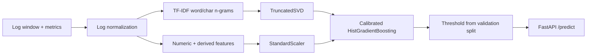
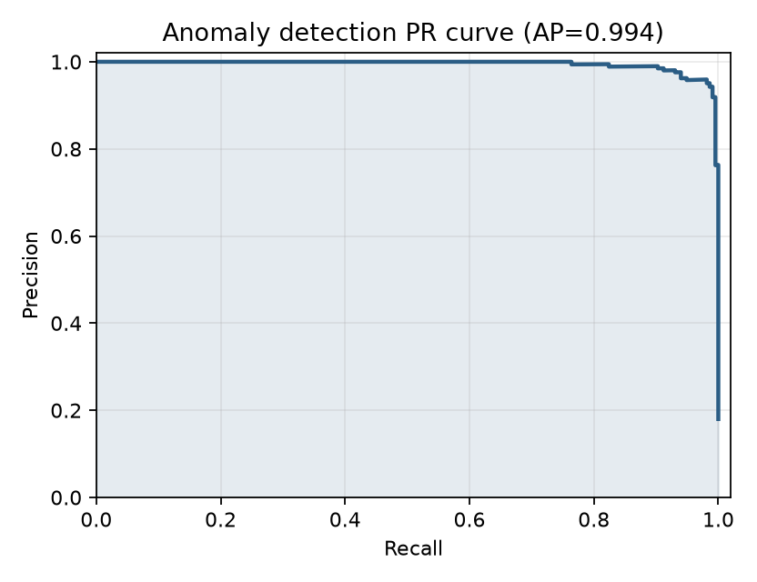
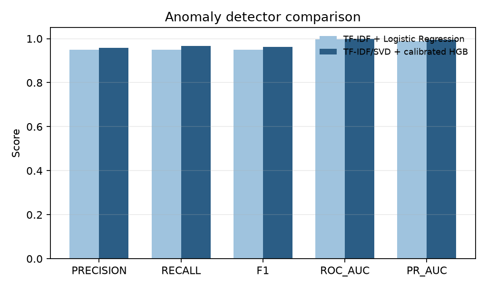
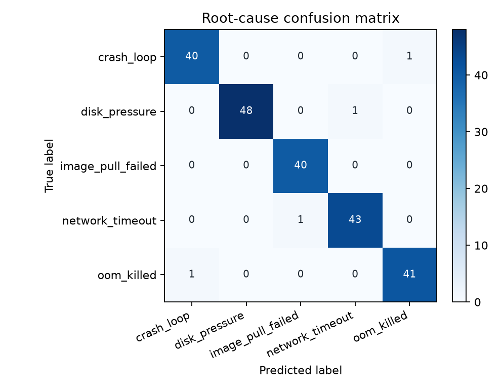

# LogSentinel

[](https://github.com/InorSogeih/logsentinel/actions/workflows/ci.yml)

面向 AI Infra 场景的日志异常检测与根因分类项目。输入一个短时间窗口内的 Pod 日志与资源指标，输出是否异常、异常分数以及最可能的根因类别。

这个项目不是简单的“分类 demo”，而是一条可复现的机器学习交付链路：数据生成、日志模板归一化、特征工程、基线/主模型对比、概率校准、阈值选择、PR-AUC 评估、FastAPI 推理、Docker 和 CI。

## 问题背景

AI 集群里，OOM、镜像拉取失败、网络超时、进程崩溃和磁盘压力经常同时表现为 `ERROR` 日志，单纯依赖关键词规则容易误报。实际排障需要同时看：

- 日志模板与错误语义
- 延迟、重试、重启、错误率等窗口指标
- CPU / 内存 / 磁盘等资源压力
- 类别不平衡下的阈值选择

LogSentinel 把这些问题拆成两个任务：

1. **异常检测**：判断窗口是否异常。
2. **根因分类**：异常窗口属于哪类故障。

## 技术方案



### 关键设计

- **日志归一化**：屏蔽 UUID、IP、路径、十六进制 ID 和数字，保留模板语义，降低训练集与线上日志的分布漂移。
- **双分支特征**：文本分支使用 TF-IDF + SVD 压缩；数值分支融合原始指标和 `error_ratio`、`retry_rate`、`resource_pressure` 等派生特征。
- **类别不平衡处理**：主模型使用验证集上的 F1 最大化阈值，而不是固定 0.5；测试集只用于最终评估。
- **概率校准**：异常检测使用 Platt scaling（sigmoid calibration），在小样本校准集上比 isotonic 更稳定，也便于设置告警阈值。
- **根因分类**：只在异常样本上训练五分类模型，输出根因和置信度。
- **工程化交付**：模型 bundle、FastAPI、Docker、pytest、GitHub Actions 一并提供。

## 数据与任务

仓库内置可复现的合成日志窗口生成器，模拟 5 类故障：

- `oom_killed`
- `image_pull_failed`
- `network_timeout`
- `crash_loop`
- `disk_pressure`

数据中包含难负例（高资源占用的正常批任务）、干扰性 WARN 日志，以及约 10% 只体现指标异常、缺少明确错误行的难例，避免模型只靠关键词作弊。

> 合成数据用于可复现实验和工程展示，不代表生产环境性能。接入真实日志时，保留 `message` 与指标字段即可复用训练流程。

## 实验结果

以下指标来自 `seed=42`、`6000` 个窗口、`60/20/20` 分层切分，阈值仅在验证集选择。

| 模型 | Precision | Recall | F1 | PR-AUC | ROC-AUC |
|---|---:|---:|---:|---:|---:|
| TF-IDF + Logistic Regression（基线） | 0.949 | 0.949 | 0.949 | 0.989 | 0.997 |
| TF-IDF/SVD + calibrated HGB（主模型） | 0.959 | 0.968 | 0.963 | 0.994 | 0.999 |

**根因分类**：macro-F1 = `0.981`，top-2 accuracy = `1.000`。







## 快速开始

要求 Python 3.10+。

```powershell
cd C:\path\to\LogSentinel
python -m venv .venv
.\.venv\Scripts\Activate.ps1
pip install -e ".[dev]"
python -m logsentinel.train --samples 6000
pytest -q
```

训练产物：

- `data/log_windows.csv`：生成的数据
- `artifacts/logsentinel.joblib`：模型 bundle
- `reports/metrics.json`：完整指标
- `reports/*.png`：PR 曲线、模型对比与混淆矩阵

## 单条推理

```powershell
python -m logsentinel.predict `
  --message "ERROR upstream timeout host=10.0.0.8 status=504 latency_ms=2400" `
  --latency-ms 2400 `
  --error-count-5m 3 `
  --request-count 80
```

输出示例：

```json
{
  "is_anomaly": true,
  "anomaly_score": 0.91,
  "root_cause": "network_timeout",
  "root_cause_confidence": 0.78,
  "model_version": "0.1.0"
}
```

## API

先训练模型，再启动服务：

```powershell
uvicorn logsentinel.api:app --reload --port 8000
```

健康检查：

```powershell
Invoke-RestMethod http://127.0.0.1:8000/health
```

调用预测接口：

```powershell
$body = @{
  message = "ERROR container terminated reason=OOMKilled memory_mb=12000"
  severity = "ERROR"
  latency_ms = 800
  memory_usage = 0.96
  restart_count = 2
  error_count_5m = 4
  request_count = 90
} | ConvertTo-Json

Invoke-RestMethod `
  -Uri http://127.0.0.1:8000/predict `
  -Method Post `
  -ContentType "application/json" `
  -Body $body
```

## Docker

先确认 `artifacts/logsentinel.joblib` 已生成，然后构建：

```powershell
docker build -t logsentinel .
docker run --rm -p 8000:8000 -v "${PWD}/artifacts:/app/artifacts" logsentinel
```

## 测试与 CI

```powershell
pytest -q
```

测试覆盖数据生成、日志归一化、派生特征、模型拟合、阈值选择和 API 端点。`.github/workflows/ci.yml` 会在每次 push 和 PR 时运行测试。

模型适用范围、数据、指标和限制详见 [MODEL_CARD.md](MODEL_CARD.md)。

## 项目结构

```text
LogSentinel/
├── src/logsentinel/
│   ├── data.py          # 合成日志窗口生成
│   ├── features.py      # 日志归一化与特征工程
│   ├── model.py         # 基线、主模型、根因模型
│   ├── evaluation.py    # 阈值选择与指标
│   ├── train.py         # 训练与评估入口
│   ├── predict.py       # 单条推理
│   └── api.py           # FastAPI 服务
├── tests/
├── reports/
├── Dockerfile
├── pyproject.toml
└── .github/workflows/ci.yml
```

## 已知限制与下一步

- 当前使用合成数据，尚未接入真实 Kubernetes / OpenTelemetry 日志。
- 根因类别是封闭集合，真实场景需要支持未知故障和开放集识别。
- 下一步可加入日志模板挖掘（Drain3）、时间序列特征、模型漂移监控、ONNX 推理和 MLflow 实验追踪。

## 发布到 GitHub

如果这是第一次上传，先在 GitHub 网页新建一个空仓库（不要勾选初始化 README），然后在本目录执行：

```powershell
git config --global user.name "<你的GitHub昵称>"
git config --global user.email "<你的GitHub邮箱>"
git init
git add .
git commit -m "feat: add log anomaly detection and root-cause classification"
git branch -M main
git remote add origin https://github.com/<你的GitHub用户名>/logsentinel.git
git push -u origin main
```

如果仓库已有 `origin`，改用：

```powershell
git remote set-url origin https://github.com/<你的GitHub用户名>/logsentinel.git
git push -u origin main
```

推送时如果弹出浏览器登录，按提示授权即可；GitHub 不再接受账户密码作为 Git 密码。也可以使用 Personal Access Token，或安装 GitHub CLI 后用 `gh auth login`。

仓库简介建议：

> AI Infra log anomaly detection and root-cause classification with calibrated ML, FastAPI, Docker, and CI.

建议添加的 Topics：`machine-learning`, `anomaly-detection`, `ai-infra`, `root-cause-analysis`, `fastapi`, `scikit-learn`, `mlops`.

如果推送时提示 `remote origin already exists`，执行：

```powershell
git remote set-url origin https://github.com/<你的GitHub用户名>/logsentinel.git
git push -u origin main
```

`data/` 和 `artifacts/*.joblib` 已被 `.gitignore` 排除，不会把大数据文件或模型二进制误传到 GitHub；`reports/` 中的指标与图片会保留，便于招聘方直接查看结果。
